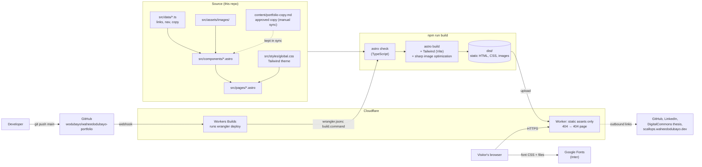

# waheedodubayo-portfolio

Personal portfolio site built with Astro, TypeScript and Tailwind CSS.

## Develop

```sh
npm install
npm run dev      # local dev server
npm run build    # type-check and build static site to dist/
npm run preview  # serve the built site
```

## Tech stack

| Layer | What | Where it's configured |
|---|---|---|
| Framework | Astro 7, static output (no SSR, no server code) | `astro.config.mjs` |
| Language | TypeScript 6, type-checked by `@astrojs/check` on every build | `tsconfig.json`, `package.json` |
| Styling | Tailwind CSS 4 via `@tailwindcss/vite`; theme tokens (ocean palette, status colors, font) in `@theme` | `src/styles/global.css` |
| Fonts | Inter, loaded from Google Fonts | `src/layouts/Base.astro` |
| Images | `astro:assets` `<Image>`, optimized at build time (sharp) from `src/assets/images/` | components that import them |
| Content | Site data and copy in TS modules (`src/data/site.ts`, `src/data/lagos.ts`); approved copy source in `content/portfolio-copy.md` | — |
| Runtime | Node 22 | `.node-version` |
| Hosting | Cloudflare Workers, static assets only (no Worker script) | `wrangler.jsonc` |
| CI/CD | Cloudflare Workers Builds, connected to the GitHub repo | Cloudflare dashboard |

There is no backend, database, API, analytics or client-side JavaScript framework.

## How it connects



## Project layout

```
src/pages/       index.astro (home), lagos.astro (/lagos case study)
src/components/  one component per section (Hero, Grocr, Lagos, Scallop, Experience, ...)
src/layouts/     Base.astro: <head>, meta, fonts
src/data/        links, nav, experience, stack, Lagos copy
src/assets/      images processed by astro:assets
content/         approved copy (keep in sync with components)
```

## Deploy

Pushing to `main` deploys automatically: Cloudflare Workers Builds runs the
deploy command, and `wrangler.jsonc` runs `npm run build` before uploading
`dist/` as static assets. Unknown paths serve the built 404 page
(`not_found_handling: "404-page"`).

Manual deploy, if needed: `npx wrangler deploy` (requires Cloudflare login).

Custom domains and DNS are set in the Cloudflare dashboard, not in this repo.

## Maintenance notes

- Upgrading Astro or Tailwind: run `npm run build` locally first, since `astro check` fails the build on type errors.
- External links (GitHub, LinkedIn, thesis, project sites) all live in `links` in `src/data/site.ts`.
- Copy changes: update both the component and `content/portfolio-copy.md`.
